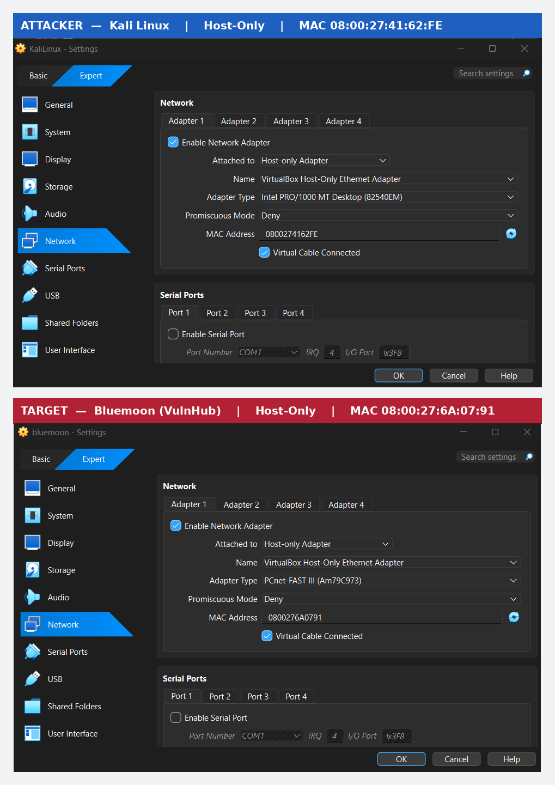
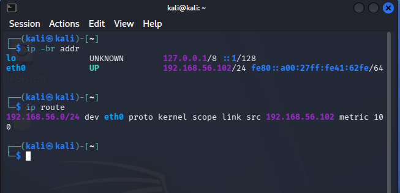
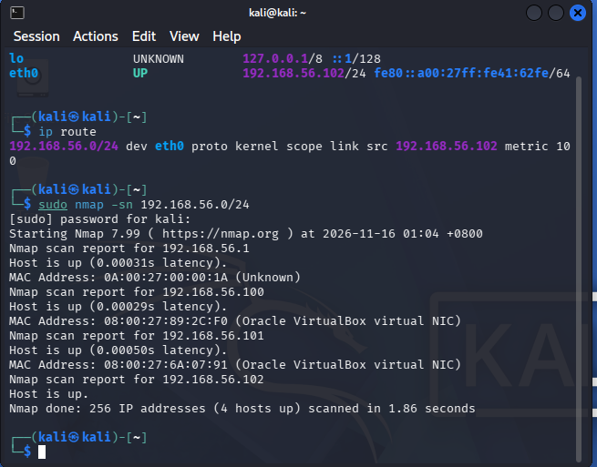
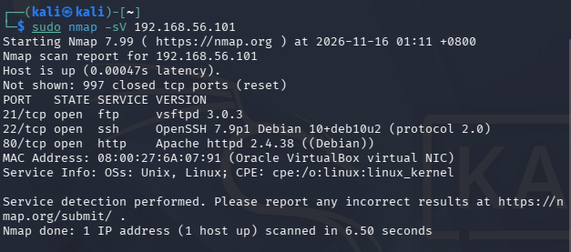

# Lab 4 — Active Reconnaissance (Footprinting)

**Name:** <Your Full Name>
**Class:** <Your Class / Section, e.g. B01>
**Course:** IKB21403 Vulnerability Analysis — Chapter 3: Reconnaissance & Footprinting
**Date:** 16/11/2026

---

## Scope

Only my own vulnerable machine (**Bluemoon**, from VulnHub) was scanned, on a
private **Host-Only** network inside VirtualBox. Both the attacker and the target
run on the same isolated Host-Only segment — no public systems were touched.
Activity was limited to **active reconnaissance** — host discovery and
port/service scanning only. **No exploitation, brute-force, persistence, or
destructive testing** was performed.

---

## 1. Target Setup (Victim) & Attacker

Both VMs are attached to the **VirtualBox Host-Only Adapter**, which keeps all
traffic on a private, isolated segment (`192.168.56.0/24`).

| Role | VM | Adapter | MAC | IP |
|------|-----|---------|-----|-----|
| Attacker | Kali Linux | Host-Only | `08:00:27:41:62:FE` | `192.168.56.102` |
| Target | Bluemoon (VulnHub) | Host-Only | `08:00:27:6A:07:91` | `192.168.56.101` |



**Target confirmation:** I did not guess which host was Bluemoon. The target VM's
adapter MAC in its VirtualBox settings is `08:00:27:6A:07:91`, and this is the
exact MAC that Nmap reported for `192.168.56.101` in both the host-discovery and
service scans below. The MAC match confirms `192.168.56.101` is Bluemoon.

---

## 2. Own Host (Attacker) & Host Discovery

- **Attacker IP / prefix:** `192.168.56.102/24`
- **Gateway:** none — Host-Only segment (only a kernel link-scope route exists, no default route), confirming an isolated network.



Host discovery with a ping sweep found 4 live hosts on the segment:
`.1` (Host-Only adapter), `.100` (VirtualBox DHCP), `.101` (Bluemoon — target),
`.102` (Kali — me).



---

## 3. Findings, Evidence and Limitations

### Findings

Service/version scan of `192.168.56.101`:

| Port | State | Service | Version (from banner) |
|------|-------|---------|-----------------------|
| 21/tcp | open | ftp | vsftpd 3.0.3 |
| 22/tcp | open | ssh | OpenSSH 7.9p1 Debian 10+deb10u2 (protocol 2.0) |
| 80/tcp | open | http | Apache httpd 2.4.38 ((Debian)) |

997 other TCP ports returned **closed (reset)** — the host actively refuses them
rather than silently dropping, indicating no packet-filtering firewall in front
of these services.

Summary: The target is a **Debian 10 ("Buster")** Linux host exposing FTP, SSH,
and a web server. All three version banners are the stock Debian 10 packages.

### Evidence



All results are taken directly from my own scan output.
Source: Nmap 7.99, run from Kali (`192.168.56.102`). Timestamp: 2026-11-16 01:11 +0800.

### Interpretation & Confidence

- Ports 21, 22, 80 are **open** and the banners identify vsftpd 3.0.3, OpenSSH
  7.9p1, and Apache 2.4.38 — all consistent with a Debian 10 host.
- Confidence: **medium** — versions are self-reported service banners, not
  independently validated.
- No service is labelled "vulnerable": Debian backports security fixes while
  keeping the version number, so an old-looking banner is **not** proof of a flaw.
  (Note: vsftpd 3.0.3 is a normal release, not the backdoored 2.3.4.)

### Limitations

- **Banners can be faked or misleading** — a reported version is an indicator, not proof.
- **Outdated-looking software is not confirmed vulnerable** — no validation or exploitation was performed.
- **Scan scope** — only the **top 1000 TCP ports** were scanned (`-sV` default); no full `-p-` range and no UDP, so other open ports may exist (false negatives possible).
- **Point-in-time** — results reflect the state at scan time only.

---

## Commands I used

```bash
# Attacker own-host details
ip -br addr
ip route

# Host discovery on the Host-Only segment
sudo nmap -sn 192.168.56.0/24

# Service / version scan of the target
sudo nmap -sV 192.168.56.101
```
